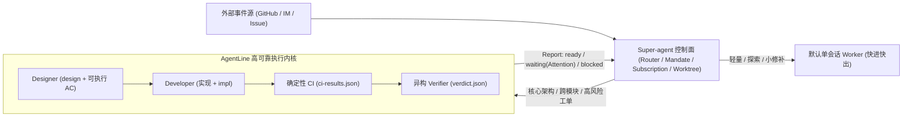

# 01 · 目标定位与开发路线调整

> 日期：2026-11-01 · 基线提交：`36b814a`
> 背景输入：DeepSeek Harness《Super-agent 设计探索：迈向更自主的 Agent 系统》及开源原型 `dsh-superagent-prototype`；`AgentLine` 在 `fovea`、`skills`、`SpringExam` 等仓库中的 `.collab/` 实测运行记录。
>
> 2026-11-03 补充：边界以 [SCOPE.md](../SCOPE.md) 为准。下文的“挂载态”指一个独立的可选适配包，内核不依赖 Super-agent；文末链接的 02、03 两份文档尚未编写。

## 1. 核心判断与定位调整

DeepSeek Harness（DSH）团队发布的 `Super-agent` 原型明确了 DSH 生态在**多任务外层控制面**上的演进方向：由常驻 `Router` 统一承接 GitHub / IM 多源事件、做两级准入（`Gate + Eval`）、通过 `Subscription` 订阅直通省去重复路由开销、用 `WorkerSlots` 和 `git worktree` 管理任务级并发，并在面板中仅呈现需要人类介入的事项（`person/*`）。

与此同时，`Super-agent` 的单任务执行层（默认 `DshExecutor`）采用**单模型、单会话包干到底**的模式。这种模式适合答疑、问题复现与轻量修改，但在高复杂度工程研发中，依然存在单模型**自审自欺、长对话规格漂移、供应商中途假死丢现场、无硬证据交付**的结构性短板——而这正是 `AgentLine` 已经验证的核心价值。

在 `Super-agent` 架构中，`Executor` 被明确设计为核心域之外的可插拔端口（Port）。基于此，`AgentLine` 的目标定位做如下收敛调整：

1. **放弃外层控制面自建，等待并复用 `Super-agent` 正式版**：`AgentLine` 不再规划多渠道消息监听、群聊主动接单、全局事件路由和跨系统通知基建。
2. **专注打磨「深度实现分支（High-Assurance Execution Kernel）」**：
   - **独立态（当前）**：作为本地高可靠研发流水线，通过 CLI / DSH 插件驱动核心仓库的复杂特性开发；
   - **挂载态（待 `Super-agent` 正式版发布后）**：作为 `Super-agent` 控制面下的高保障 `Executor` 实现，与默认单会话快速 Worker 形成**「快慢双分支」**——轻量工单走默认单会话 Worker 快进快出，核心架构与高风险代码工单路由至 `AgentLine` 走「设计锁规格 → 开发实现 → 确定性 CI 取证 → 异构模型只读验收 → 人类合并闸门」。

---

## 2. 职责边界与范围裁剪对照

图例：✅ 保留并强化 · 🔄 改造以对齐 `Executor` 端口 · ⛔ 冻结不做（交由 `Super-agent` 正式版承担）

| 能力模块 | 调整判定 | 调整说明 |
| --- | --- | --- |
| **三角色隔离 + 固定文件交接** | ✅ 保留并强化 | `designer` / `developer` / `verifier` 独立上下文与固定文件契约是防止长对话规格漂移的核心护城河。 |
| **可执行验收命令 + CI 原始证据** | ✅ 保留并强化 | `acceptance.md` 锁定可独立复现命令，`ci-results.json` 记录退出码与输出，杜绝口头“已测试”。 |
| **开发与验证跨模型硬隔离** | ✅ 保留并强化 | 从“角色自填模型名互相比较”升级为**调度器按进程级真实 `model_resolved` 强制校验**。 |
| **平级换模 + Checkpoint 现场交班** | ✅ 保留并强化 | 最多 2 次候选切换、不升 `effort`、切换前落盘交班单、接班显式选择保留/回滚、校验 `no_new_work`、认证失败不静默降级（`blocked(auth)`）。 |
| **人类最终合并闸门（Merge Gate）** | ✅ 保留并强化 | 即使未来接入 `Super-agent`，深度分支默认也只推进到 `pr_open` / `ready`，不开启自动合并。 |
| **工作目录与仓库锁模型** | 🔄 内核解耦改造 | 废弃“锁死整个仓库并在主工作区原位切分支（后到 `exit 2`）”，改为**外部注入 `--workdir`（兼容 `git worktree` 与 `DSH_SUPERAGENT_DIR`）+ 单任务/单工作树细粒度锁**。 |
| **子进程监控与 `stall` 判定** | 🔄 内核效率改造 | 实测 `fovea` 任务出现多次 600 秒盲等 `stall`（`exit 125`）。改为 **CLI 事件流心跳 + 活跃子进程租约**双层检测，缩短故障切模耗时。 |
| **中途人类干预（现 `mailbox`）** | 🔄 契约化改造 | 为兼容未来 `Super-agent` 的订阅直通消息（`Input`），将非正式的 `mailbox` 升级为阶段感知的受控输入（区分不改规格的 `note` 与触发重设计的 `amendment`），并补充 `designer` 单问题挂起（`Attention`）。 |
| **对外状态出口与协议基线** | 🔄 契约统一改造 | 消除当前 `SKILL.md v0.1.0` 与调度器真实产物（`run.json`、`ci-results.json`、`verdict.json`）之间的漂移；对外输出对齐五态 `Report`（`progress / waiting / ready / blocked / failed`）。 |
| **多渠道 Source 接入（飞书/GitHub 轮询）** | ⛔ 冻结不做 | 等待 `Super-agent` 正式版提供标准 Source 生态。 |
| **全局 Router 事件批处理与主动接单策略** | ⛔ 冻结不做 | `off / observe / auto` 准入与跨会话分派属外层控制面职责。 |
| **跨渠道运营 Web 面板与消息 Outbox** | ⛔ 冻结不做 | `AgentLine` 仅维护结构化状态文件与标准事件输出，不自建重型 Web 控制台。 |

---

## 3. 调整后的开发路线图

在 `Super-agent` 正式版发布前，所有迭代均需同时满足两个标准：**① 今天就能直接提升本地多仓库（如 `fovea`、`SpringExam`）研发体验；② 零废弃代码，未来可直接映射到 `Super-agent` 的 `Executor` 接口。**

| 阶段 | 版本目标 | 核心交付内容 | 解决的当前痛点 / 对接价值 |
| --- | --- | --- | --- |
| **阶段一** | **`v0.2.0` 协议与取证对齐** | 1. 升级 `AgentLine/SKILL.md` 与 `templates/` 至 `v0.2.0`，消除与调度器真实 `state.json` / `run.json` / `ci-results.json` / `verdict.json` 的契约漂移 2. 新增零依赖只读产物审计脚本 `AgentLine/tools/check-task.ps1`（机械校验跨模型隔离、`git_sha` 一致性与写入路径白名单） | 消除文档误导模型按旧 7 文件格式操作的问题；把防伪校验从“靠模型自觉”收归机械脚本。 |
| **阶段二** | **`v0.3.0` Worktree 解耦与流式心跳** | 1. 调度器支持 `--workdir <path>` 外部工作树注入，锁粒度从整仓 `.collab/.flow.lock` 收缩至单 Task / Worktree 2. 引入 CLI 流式输出增量心跳与子进程树存活探测，替代固定 600 秒硬超时 | 主工作区不再被单个 90 分钟长任务锁死，支持多 worktree 并行；将 API 断流假死的无效等待从 10 分钟压缩至 90 秒内。 |
| **阶段三** | **`v0.4.0` 受控直通输入与标准汇报** | 1. 正式化阶段感知 `Input` 队列（`note` / `amendment` / `review_comment`）与消费位点回执 2. 支持 `designer` 阶段发出单问题结构化 `Attention` 挂起等待拍板 3. 统一输出五态标准 `Report` 事件流 | 替代零散的 `mailbox` 插话，允许人在 PR / 执行中途安全纠偏而不破坏「规格先行」；对外语义与 `Super-agent` 完全同构。 |
| **阶段四** | **`v1.0.0` Super-agent 深度分支挂载** | 待 `Super-agent` 正式版发布后，编写薄适配层 `AgentLineExecutor`：将 `Assignment` 转为 `brief.md` + `--workdir`，将订阅直通 `Input` 桥接至阶段输入队列，将状态变更回调至 `EngineForExecutor.report`。 | 正式合流为「Super-agent 外层调度 + AgentLine 深度执行」的双模自主研发系统。 |

---

## 4. 下一步立即启动范围

下一步优先落地**阶段一（`v0.2.0` 协议与机械取证对齐）**与**阶段二/三的核心接口契约定义**，确保协议仓库（`dsh-Agentline`）与调度器实现围绕同一套 `v0.2` 数据结构演进。具体需求与技术规格见：

- [02 · 下一步演进需求规格](./02-v0.2-requirements.md)
- [03 · 下一步技术设计文档](./03-v0.2-technical-design.md)
